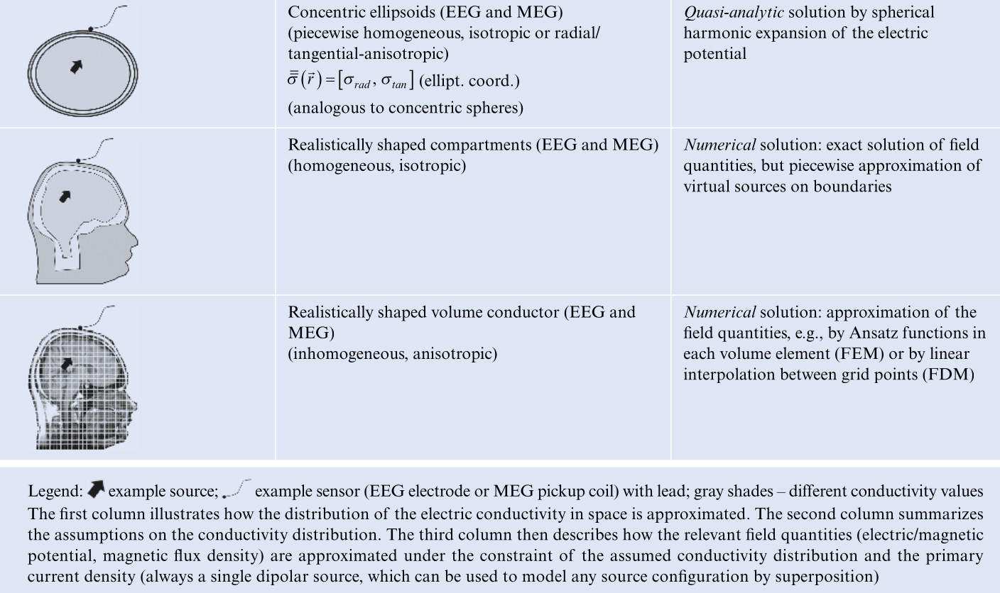

# Forward Problem

## Background
An essential part of any source reconstruction procedure is the computation of the EEG and MEG sensor outputs under the assumption of known sources, which are mathematically approximated by souce models. This process is generally referred to as solving the **forward problem** or **direct problem**, as opposed to the **inverse problem** consisting of the reconstruction of sources from known EEG or MEG data.  

The central component of the forward problem is the mathematical description of the electric and magnetic fields in and around the human head. Just like any other electromagnetic phenomenon, this description is essentially based on Maxwell's equations, while some approximations and simplifications can be applied leading to the so called Poisson's equations. Apart from these equations, the actual spatial distribution of the electric and magentic fields and the associated potentials is constrained by two factors: the spatial distribution of the primary current density (defined by the Source model) and the spatial distrbution of the electric conductivity.

The different approaches to the forward model mainly differ in the way the conductivity profile is approximated (see Figure 1, `bem.ipynb`, `fem.ipynb` and `fwd.ipynb`)

  
*Figure 1: Classification of Head Models*

The solution to the forward problem also requires the sensors (electrode channels or magnetic coils) to be coregistered with the generated head model (see `coreg.ipynb`). 

## Protocol:
1. `bem.ipynb`: Generates a BEM head model OR `fem.ipynb`: Generates a FEM head model
2. `coreg.ipynb`: Coregisters the electrode channels to the head model.
3. `fwd.ipynb`: Generates the forward operator using a head model (BEM or FEM) with the corrected sensor locations.

